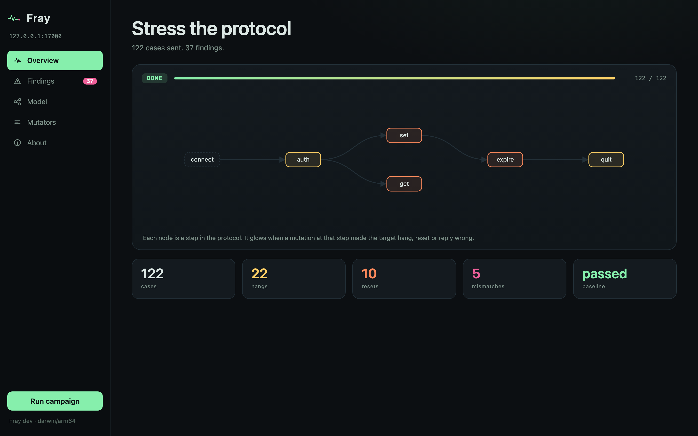
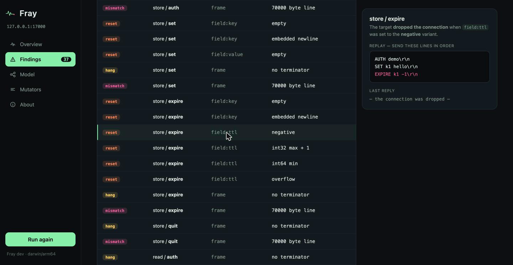
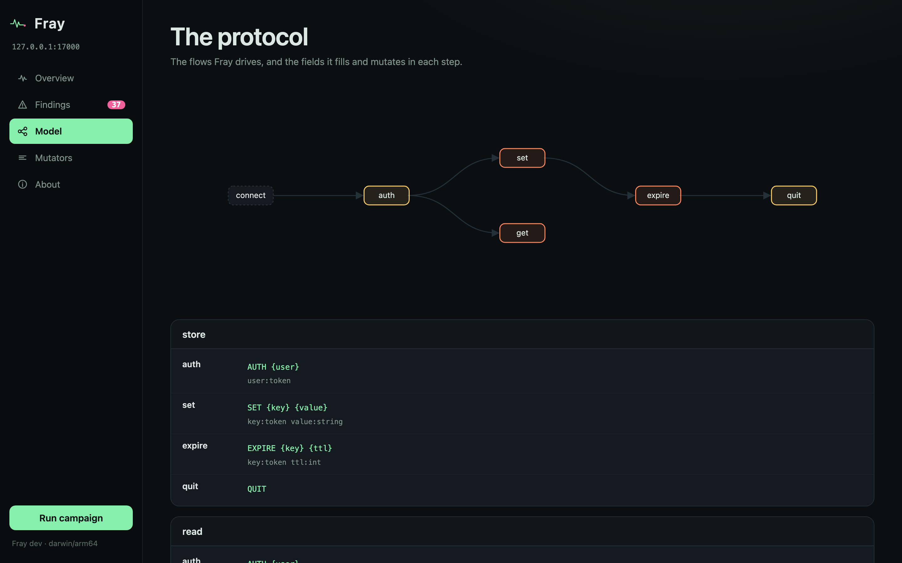

<picture>
  <source media="(prefers-color-scheme: dark)" srcset="docs/assets/wordmark-dark.svg">
  
</picture>

[](https://github.com/cansarihan/fray/actions/workflows/ci.yml)
[](https://github.com/cansarihan/fray/actions/workflows/codeql.yml)
[](https://goreportcard.com/report/github.com/cansarihan/fray)
[](go.mod)
[](LICENSE)

Fray tests one of your own network services against a model of its protocol. You
describe the conversations the service supports and the fields in each message;
Fray walks them once to be sure they work, then sends every message again with
one part replaced by something hostile — an empty value, a megabyte of text, a
boundary number, a broken line ending — and reports where the service hangs,
drops the connection or stops speaking its own protocol.

Every finding keeps the exact lines that caused it, so it replays byte for byte.
One binary, nothing outside the standard library.



## A model

A model is JSON — flows of steps, each a message template with typed fields and
the reply it expects:

```json
{
  "name": "kv",
  "banner": "^\\+OK",
  "flows": [
    {"name": "store", "steps": [
      {"name": "auth", "send": "AUTH {user}", "expect": "^\\+OK",
       "fields": {"user": {"type": "token", "seed": "demo"}}},
      {"name": "set", "send": "SET {key} {value}", "expect": "^\\+OK",
       "fields": {"key": {"type": "token", "seed": "k1"}, "value": {"type": "string", "seed": "hello"}}}
    ]}
  ]
}
```

## On the command line

```console
$ fray fuzz -model kv.json -target 127.0.0.1:7000
kv against 127.0.0.1:7000
122 cases in 11.4s · 10 reset, 22 hang, 5 mismatch

RESULT    FLOW/STEP      TARGET       MUTATION        REPLY
reset     store/set      field:value  empty
reset     store/expire   field:ttl    negative
reset     store/expire   field:ttl    int32 max + 1
hang      store/auth     frame        no terminator
mismatch  store/set      frame        70000 byte line  -ERR unknown command "AAAA…
```

The target defaults to loopback. Point Fray at another host only with
`-allow-remote`, and only one you are authorized to test.

## The panel

`fray serve` hosts a panel built around the protocol's state graph. Press Run and
each step lights up as a mutation there makes the target hang, reset or reply
wrong. Every finding opens with the exact lines to replay it.

| | |
|---|---|
|  |  |

## What Fray sends

| Target | Variants |
|---|---|
| string / token fields | empty, 1 KiB and 64 KiB values, printf and template markers, quotes and separators, embedded newlines and null bytes, control and high bytes, invalid UTF-8 |
| integer fields | zero, negative, the int32 and int64 boundaries, an overflowing number, a non-number, padded and spaced forms |
| the message frame | no terminator, a doubled terminator, a lone LF, a smuggled second command, a 70 KB line |

`fray mutators` prints the catalogue.

## A finding, replayed

Each finding carries the lines Fray sent, so you can reproduce it with anything:

```console
$ printf 'AUTH demo\r\nSET k1 hello\r\nEXPIRE k1 -1\r\n' | nc 127.0.0.1 7000
```

## Commands

```console
$ fray fuzz -model m.json -target host:port   # run a campaign
    -timeout <dur>     per-reply timeout; a slower reply counts as a hang
    -allow-remote      permit a non-loopback target
    -json | -md        JSON, or a Markdown digest with replay blocks
$ fray model -model m.json     # validate a model and print its state graph
$ fray mutators                # print the mutator catalogue
$ fray target -listen host:port    # run the demo key-value service
$ fray serve -model m.json -target host:port   # host the panel
$ fray version
```

## HTTP API

```console
GET  /api/v1/status     build info and run state
GET  /api/v1/model      the flows, fields and state graph
GET  /api/v1/mutators   the mutator catalogue
GET  /api/v1/findings   findings so far
POST /api/v1/run        start a campaign
GET  /api/v1/stream     server-sent progress and findings
```

## Run the demo

The demo runs a small key-value service with a few deliberate bugs — a missing
argument, a bad TTL — and fuzzes it.

```sh
make demo          # panel at http://127.0.0.1:18220, press Run
make demo-down
make run           # the same without Docker
```

## Build

```sh
make build         # ./bin/fray
make test          # opens loopback sockets
make lint
```

## License

MIT. See [LICENSE](LICENSE).
