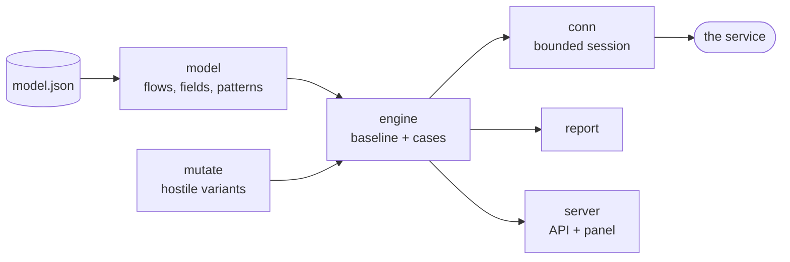

# Architecture

Fray turns a description of a protocol into a test campaign against a service
that speaks it.

## The model

A model is JSON: a protocol has flows, a flow has ordered steps, a step is a
message template with typed fields and a regular expression the reply must match.
The same model drives three things: the baseline run that proves the protocol
works, the mutation cases, and the state graph the panel draws.

## How a campaign runs

1. **Baseline.** Every flow is run once with seed values. If any step fails to
   get the expected reply, the campaign stops — there is no point mutating a
   protocol the target does not speak.
2. **Cases.** For each step, every field is replaced in turn with each variant a
   fitting mutator produces, and the whole message is replaced with each framing
   variant. One case is one connection: the steps before the target are replayed
   with seed values, then the mutated message is sent.
3. **Judgement.** The reply decides the outcome — a clean match is nothing, a
   non-matching reply is a *mismatch*, a dropped connection is a *reset*, and no
   reply in time is a *hang*. A reset outranks a hang, which outranks a mismatch.
4. **Repro.** Every finding keeps the exact lines sent, so it replays byte for
   byte.

## Mutators

Mutators are small and independent. Field mutators send an empty value, values
thousands of bytes long, printf and template markers, injection metacharacters,
and control bytes; integer fields get boundary, oversized, negative and
non-numeric values; framing mutators strip, double or smuggle past the line
terminator. Each variant carries a label, so a finding names the idea that
caused it.

## Packages

- `internal/model` parses and validates a protocol model and builds its state
  graph.
- `internal/mutate` holds the mutators and dispatches them by field type.
- `internal/conn` speaks the protocol over one connection, under a deadline and
  a read cap, classifying each reply.
- `internal/engine` runs the baseline and the cases, concurrently where it can,
  and streams findings.
- `internal/report` renders a run as a table, JSON, or a Markdown digest with a
  replay block.
- `internal/server` runs one campaign in the background and serves its progress,
  findings and the state graph to the panel over server-sent events.
- `internal/target` is the demo key-value service, carrying the bugs the demo
  model is built to find.

## Safety

Fray sends malformed traffic, so a non-loopback target is refused unless
`-allow-remote` is given. Every connection is bounded in time and in bytes read,
and nothing a target replies is ever executed — it is only matched against the
model's pattern. The panel fuzzes one fixed target chosen at startup and cannot
be redirected by a request.
